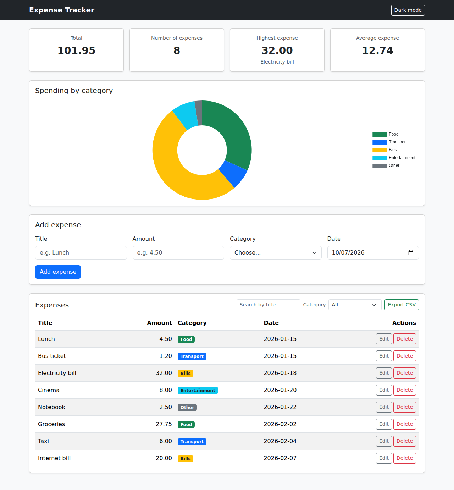
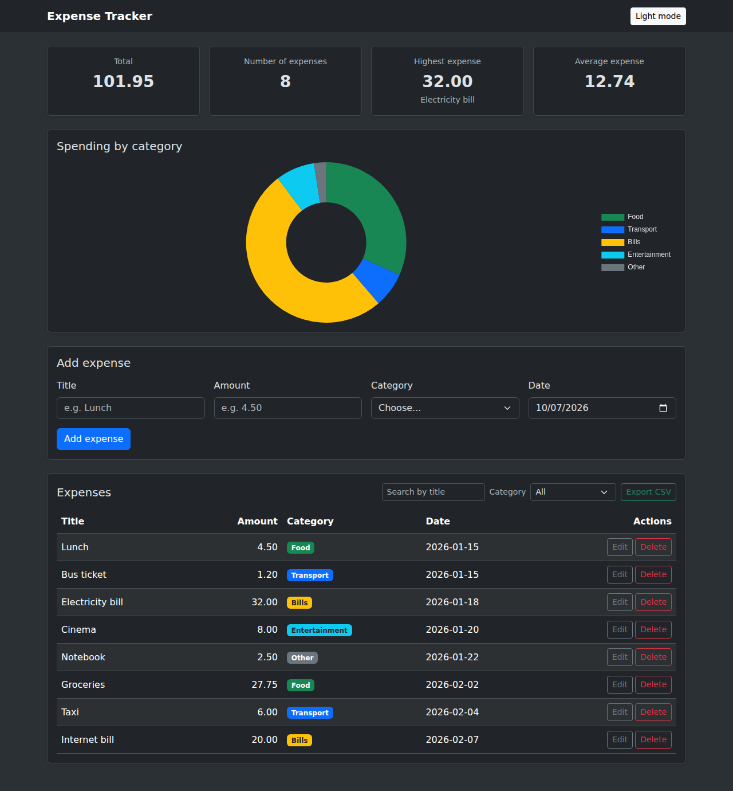
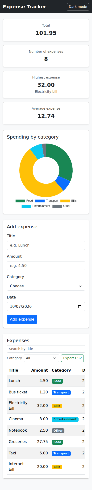

# Expense Tracker

A full stack web app to track personal expenses. You can add, edit, and delete expenses, filter them by category, search them by title, see a summary (total, number of expenses, highest expense, and average), see a chart of spending by category, export the list to a CSV file, and switch between light and dark mode. The data is saved in a PostgreSQL database through a REST API built with Node.js and Express.



## Tech stack

- **Frontend:** HTML, CSS (CSS Grid), JavaScript (`fetch` + `async/await`), Bootstrap 5.3, Chart.js 4
- **Backend:** Node.js, Express, `pg` (node-postgres), `cors`, `dotenv`
- **Database:** PostgreSQL

## Project structure

```
expense-tracker/
├── frontend/
│   ├── index.html        the page (Bootstrap)
│   ├── css/style.css     custom styles (CSS Grid for the summary cards, chart size)
│   └── js/app.js         all the page logic (fetch, DOM, validation, chart, CSV, dark mode)
├── backend/
│   ├── server.js         the Express API
│   ├── schema.sql        creates the expenses table with sample data
│   ├── package.json      the project packages
│   └── .env.example      the settings you need to write in .env
├── screenshots/          screenshots of the app
├── .gitignore            keeps node_modules and .env out of GitHub
└── README.md
```

## How to run

You need **Node.js**, **PostgreSQL** (with pgAdmin), and **VS Code** with the **Live Server** extension. The page loads Bootstrap and Chart.js from a CDN, so you need an internet connection.

### 1. Get the code

```bash
git clone https://github.com/zreigat84aseel/expense-tracker.git
cd expense-tracker
```

### 2. Database

1. Open pgAdmin and create a new database named `expense_tracker`.
2. Right-click `expense_tracker`, choose **Query Tool**, paste the full content of `backend/schema.sql`, and run it (Execute).
3. This creates the `expenses` table and adds 8 sample expenses. You can run it again at any time to reset the data.

### 3. Backend

1. In the `backend` folder, copy `.env.example` to a new file named `.env`.
2. Open `.env` and write your PostgreSQL password in `DB_PASSWORD`.
3. Open a terminal in the `backend` folder and install the packages:
   ```bash
   npm install
   ```
4. Start the server:
   ```bash
   node server.js
   ```
   You should see `Server running on http://localhost:3000`. Keep this terminal open.
5. To check it, open `http://localhost:3000/api/expenses` in the browser. You should see the expenses as JSON.

### 4. Frontend

1. Keep the backend running.
2. In VS Code, right-click `frontend/index.html` and choose **Open with Live Server**.
3. The page opens in the browser and loads the expenses from the API.

## API endpoints

Base URL: `http://localhost:3000/api/expenses`

| Method | Endpoint | What it does | Status codes |
|---|---|---|---|
| GET | `/api/expenses` | Returns all expenses (oldest first) | 200 |
| GET | `/api/expenses/:id` | Returns one expense | 200, 404 |
| POST | `/api/expenses` | Adds a new expense | 201, 400 |
| PUT | `/api/expenses/:id` | Updates an expense | 200, 400, 404 |
| DELETE | `/api/expenses/:id` | Deletes an expense | 200, 404 |

**Request body for POST and PUT:**

```json
{
  "title": "Coffee",
  "amount": 2.5,
  "category": "Food",
  "date": "2026-09-25"
}
```

**Validation** (the server answers `400` with a `message` that explains the problem):

- `title` is required and cannot be empty (100 characters max).
- `amount` must be a number greater than 0.
- `category` must be exactly one of: `Food`, `Transport`, `Bills`, `Entertainment`, `Other`.
- `date` is required, in the format `YYYY-MM-DD`, and must be a real date.

The client never sends an `id`. The database creates it. A wrong or missing `id` gets `404`.

## Security

- Every query sends the values as parameters (`$1`, `$2`...), never joined into the SQL text, to prevent **SQL injection**.
- The page shows the data with `textContent`, never `innerHTML`, so a title cannot run as HTML (**XSS**).
- The data is checked twice: in the browser (for a fast, clear message) and on the server (because the browser check can be skipped).
- The database password is in `.env`, which is listed in `.gitignore`, so it is never uploaded to GitHub.
- The CSV export protects against **CSV injection**: a title that starts with `=`, `+`, `-`, or `@` gets a `'` in front, so Excel shows it as text and does not run it as a formula.

## Features

- [x] Add an expense with a form (with validation and clear error messages)
- [x] Delete an expense (with a confirm message)
- [x] Edit an expense in a Bootstrap modal filled with the current data
- [x] Filter by category, with an "All" option
- [x] Summary cards: total, number of expenses, highest expense, and average expense (always counting all the expenses, not the filtered list)
- [x] Category shown as a coloured badge in the table
- [x] Data is saved in a PostgreSQL database
- [x] After every add, edit, or delete, the page asks the server for the list again
- [x] Success alerts that show the title of the expense (for example `Expense "Coffee" added.`)
- [x] Loading spinner, and a clear Bootstrap alert for every error (including when the server is off, and the server's own message after a 400)
- [x] Responsive design (phone, tablet, and desktop), with CSS Grid for the summary cards (1, 2, or 4 columns)

### Bonus

- [x] **Search by title:** a search box next to the filter. It works together with the category filter and does not care about capital letters.
- [x] **Dark mode:** a button in the navbar switches the whole page between light and dark, using Bootstrap's `data-bs-theme`. The page remembers your choice next time you open it.
- [x] **Chart:** a doughnut chart (Chart.js) shows how much money went to each category, in the same colours as the badges. Like the cards, it uses all the expenses. It also changes its text colour in dark mode.
- [x] **Export CSV:** a button downloads the expenses shown in the table (after the filter and the search) as a `.csv` file that opens in Excel. Arabic titles show correctly, and titles with commas or quotes stay in one cell.

## Screenshots

**Desktop**


**Dark mode**



**Phone**



**API tests:** the Thunder Client screenshots (one success and one error for every endpoint) are in the `screenshots/api-tests` folder.

## What was the hardest part?

The hardest part for me was connecting all the pieces together for the first time, because a small mistake in one place stopped everything, and the error was not always clear. For example, I ran `schema.sql` on the practice database (`expense_tracker_practice`) instead of `expense_tracker`, so the server could not find the table. I also started the server twice by mistake, so port 3000 was already in use and the second one did not start. And when I tested POST in Thunder Client for the first time, I forgot to fill the Body tab, so the server answered 400. I solved these problems by reading the error messages carefully: I checked which database the Query Tool was connected to, I stopped the old server with Ctrl+C before starting a new one, and I improved `app.listen` so it prints a clear message when the port is busy. I also learned that `pg` returns `NUMERIC` as text and `DATE` as a JavaScript Date that can move one day back because of the time zone, and I fixed both in the SQL with `amount::float8` and `to_char(date, 'YYYY-MM-DD')`.
